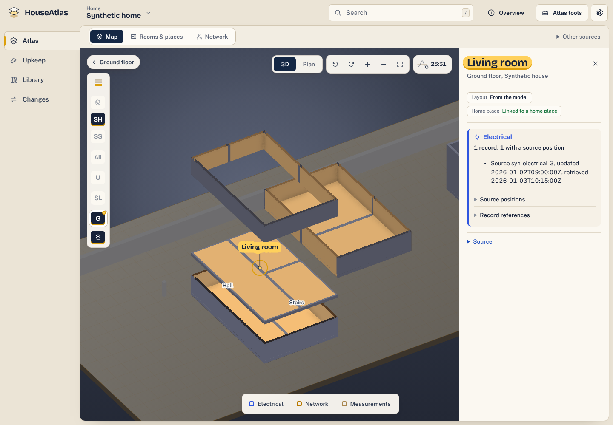

# HouseAtlas

HouseAtlas connects rooms, belongings, documents and physical infrastructure in a home atlas. Browse a home without a floorplan, select a building and its reviewed rooms, and keep source dates, unknowns and evidence visible.

HomeBox owns inventory, attachments and maintenance; HouseAtlas owns physical identities, reviewed bindings and optional geometry, circuits and valves. Network observations are a separate passive, read-only source. Browsing does not collect data or write upstream.




**SYNTHETIC demo.** The Atlas shows a generated fictional house model through the application's actual reader and renderer. Its buildings, rooms and records are invented. The browsing fixture has no house model. No household files, real accounts or live providers are used. [Full screenshots and reproduction](docs/demo/README.md).

## Try the synthetic interface

Use Node **26.10.0** and npm **11.19.1**, then run from the repository root:

```sh
npm ci --prefix frontend --ignore-scripts --no-audit --no-fund
(cd frontend && node node_modules/vite/bin/vite.js --host 127.0.0.1 --port 4179 --strictPort)
```

Open <http://127.0.0.1:4179/lantern-tests/source-host-visual/?atlas=generated> for the generated fictional house model. Select a room or switch between **3D** and **Plan**. Open <http://127.0.0.1:4179/lantern-tests/core-read-visual/> and select **Alpha** for building membership and source facts; in **Network**, choose **Load Network relations** for the fixture's saved relation. Stop the server with Ctrl-C.

The Atlas demo uses the production scene reader against an in-page fake transport serving a generated publication. The browsing demo uses read clients with synthetic Responses. They supply no authentication, native server, evidence upload or provider integration. Keep it on loopback; do not use it as a deployment.

## What you can explore

- **Rooms and places:** reviewed building and floor membership, room records and explicit unplaced or unknown information. Names and tree depth do not establish physical placement.
- **Belongings and documents:** HomeBox projections, source-owned attachments, availability and maintenance. HomeBox edits use verified native links.
- **Geometry and infrastructure:** optional reviewed geometry and separately owned circuit, valve and evidence records. Geometry is not required for browsing.
- **Source history:** distinct fact and retrieval dates, uncertainty, stale caches and corrections. Passive Network reads never send collector demand.

Some capabilities require a configured native host and reviewed source bindings; these demos show fictional illustrated geometry, building/room browsing, a saved Network relation and separately generated provisional mesh presentation.

## Run the offline core checks

After inspecting the named script bodies, install the exact dependency locks and run the ordinary synthetic core:

```sh
npm ci --ignore-scripts --no-audit --no-fund
npm ci --prefix packages/contracts --ignore-scripts --no-audit --no-fund
npm run verify:publication
npm run build:ordinary
node --check packages/contracts/history/check-history.mjs
npm run check:http:ordinary
npm run test:ordinary
```

These checks cover publication integrity, module syntax/builds, valid HTTP history examples and one healthy synthetic Request group. `test:ordinary` and the `server/` and `web/` part of `build:ordinary` check the JavaScript reference core and UI ([server/README.md](server/README.md)), not the running Rust/React service. They call no provider and certify no security, live integration or deployment readiness. New explicit source-presence admissions remain blocked pending their separately reviewed extension.

Focused synthetic checks for the canonical IFC source, IFC/GLB, IFC publication and canonical geometry seams are listed with their scope and limits in the [verification guide](docs/contributing/verification.md#canonical-ifc-source-ifcglb-and-publication-seam-checks). The IFC publication check includes the two-floor synthetic fixture of the proposed [v2 scene read contract](docs/canonical-ifc/scene-read-contract-v2.md).

## Development and verification

Before committing and publishing Rust changes, run `mise run fmt` in an owned
checkout, review the diff, refresh the publication manifest, then run
`mise run fmt:check`. Follow the [writer sequence and prerequisites](docs/contributing/formatting.md).
These repository tasks work in saved cloud and Mac checkouts; explicit writer
use is required and existing CI remains the check-only backstop.

The current development snapshot includes a Rust backend, SQLite persistence and a React interface with strict TypeScript.

[The complete verification guide](docs/contributing/verification.md) retains every previously documented named command and its scope, prerequisites and limitations. Read it before running any other check; broad suites and held controls are not authorized by this README.

- [Rust/React development slice](docs/rust-integration/README.md): actual native source, disposable local settings and exact ordinary commands.
- [Reference UI contract](web/README.md): source ownership, access, freshness and host seams of the JavaScript reference UI; [frontend/src/app/INTEGRATION.md](frontend/src/app/INTEGRATION.md) records the React port against it.
- [Repository coordination](docs/coordination/worker-handoff.md) and [publication provenance](docs/publication/provenance.md).
- [Operations and rollout](docs/operations/qualification-and-rollout.md): target and acceptance requirements.
- [NAS deploy tool](tools/deploy-nas/README.md): deploy a `main` commit or a model release to the NAS, and roll it back; `python3 -m unittest discover -s tools/deploy-nas -p 'test_*.py'` checks it with a fake service.

This is a development snapshot. No household configuration, credentials or real media belong in Git. Ordinary CI uses no secrets and performs no deployment. Product, recovery, pilot and production acceptance remain separate. Open-source licensing is a future release decision; no license has been selected.
