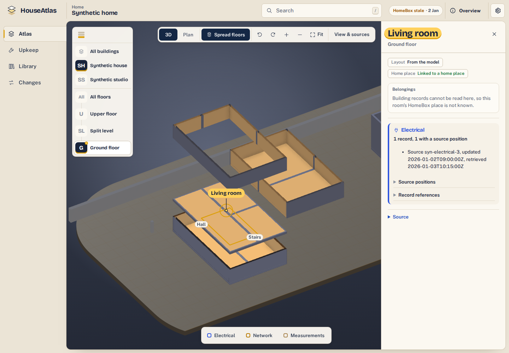
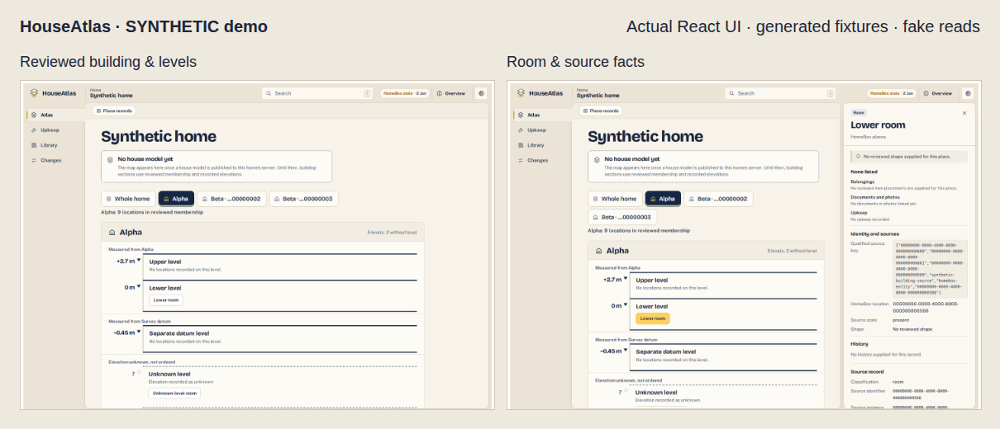

# HouseAtlas

HouseAtlas is a map of your home. It puts buildings, floors and rooms in one place, together with the belongings, documents, electrical drawings and network devices that relate to them. You can open it without a floorplan; a 3D model is optional. It keeps what each source said, when it said it, and what is still unknown.





**SYNTHETIC demo.** These images show the actual React interface with a generated fictional house and invented records. No household files, real accounts or live providers are used. [Screenshots and how they are made](docs/demo/README.md).

## What it does

- **Atlas:** buildings, floors and rooms in **3D** or **Plan**, or as building sections when there is no house model. Turn on the **Electrical**, **Network** and **Measurements** layers to see records on the map. Belongings with no reviewed room stay listed as unplaced rather than guessed.
- **Belongings and upkeep:** a read-only copy of your HomeBox inventory, attachments and maintenance, shown with how old the copy is. Changes are made in HomeBox itself.
- **Library:** source documents and electrical drawings, opened in the built-in viewer, with their recorded dates and origin.
- **Network:** devices drawn in their reviewed rooms, with links styled as wired, wireless or unknown, and a logical graph that traces a device's route to the network root. It shows associations, not cable routes.
- **Offline:** after one online visit, the app opens without a connection and keeps your edits until you are back.

HouseAtlas owns physical identities, reviewed links between sources, and optional geometry, circuits and valves. HomeBox owns inventory, attachments and maintenance. Network data comes from a separate collector. Browsing never writes to HomeBox or asks the collector to do anything.

## Try the example house

The example house runs the actual app against a fictional house, entirely in the browser. You need Node **26.10.0** and npm **11.19.1**. From the repository root:

```sh
npm ci --prefix frontend --ignore-scripts --no-audit --no-fund
(cd frontend && node node_modules/vite/bin/vite.js --host 127.0.0.1 --port 4179 --strictPort)
```

Then open <http://127.0.0.1:4179/example/index.html>. Things to try:

- Select **Living room**, then turn on the **Network** layer. Tap a device or a link to see its card.
- [Hall in Plan](http://127.0.0.1:4179/example/index.html?building=syn-building-house&floor=syn-level-ground&room=syn-room-hall&view=plan): turn on **Electrical**, open *Fictional symbol 1* and choose **Show drawing group**.
- **Library** › **Source documents** › *Synthetic parcel survey* opens a generated PDF.
- **Place records** in the rooms panel lists belongings with no reviewed room; **Upkeep** shows the reading lamp's entries.

Stop the server with Ctrl-C. Two smaller previews use the same server: <http://127.0.0.1:4179/lantern-tests/source-host-visual/?atlas=generated> (the 3D image above) and <http://127.0.0.1:4179/lantern-tests/core-read-visual/> (select **Alpha** for building sections without a house model). They use fake data in the page, with no sign-in or server. Keep them on loopback; they are not a deployment. The [demo guide](docs/demo/README.md#example-house) lists every feature area and link.

## Run your own host

A configured host is one Rust binary (`houseatlas`) with SQLite storage, serving the built React app over HTTPS. Build it with Rust 1.99.0 (pinned in `rust-toolchain.toml`) and the Node and npm versions above:

```sh
cargo build --release --locked -p houseatlas-backend
(cd frontend && npm ci && npm run typecheck && npm run build)
```

Write a private `server.json` (data folder, frontend folder, TLS certificate and key, listen address, HTTPS origin, homes) and initialize a new data folder once, then serve. This example is for the default password sign-in:

```sh
./target/release/houseatlas initialize --server-config /absolute/private/server.json --provisioning-file /absolute/private/provisioning.json
./target/release/houseatlas serve --server-config /absolute/private/server.json
```

Run these from the repository root; with a custom `CARGO_TARGET_DIR`, the binary is in its `release/` folder instead. Set `frontendDirectory` in `server.json` to the absolute path of the build output, `<repository>/frontend/dist`.

The provisioning file names the accounts, passwords and home memberships; `serve` never reads it. For a single person on one machine, the password-free loopback mode signs in with **Open Home** instead; its `initialize` omits `--provisioning-file`, which that mode refuses. [Persistent server](docs/operations/persistent-server.md) gives the exact file formats, both sign-in modes and recovery. The host also serves the example house at `/example/index.html`; **Settings** › **Open example house** links to it.

### Library files on this device

In **Settings** › **Offline storage**, **Keep Library files on this device** downloads source documents and electrical PDFs while they fit the app's storage budget; **Keep library now** fills it on demand. Opening a HomeBox file with **Open file** also keeps it (files over 10 MiB excepted). Held files show **On this device** in Library and open offline. The browser may still clear stored files; **Ask browser to keep storage** requests that it doesn't. Details: [live copy](docs/offline-live-copy.md).

### Offline and back to live

After one online launch, opening the app without a connection shows the Atlas as this device last read it. Supported edits made offline wait on the device under **Changes on this device**. When the server answers again, the app shows **Back online · Open live** (with the number of waiting changes); **Open live** returns to the live app, where waiting changes send automatically, or on **Send now** if **Sync** is set to **When I ask**. A change the server can't accept as is moves to **Needs you**, where you keep yours, use the server's or discard it.

Evidence files saved from **Add evidence** are separate: they stay as unsent local drafts in this browser and never upload on their own. Open live, sign in, review each draft and confirm to upload it. Details: [root offline entry](docs/offline/root-offline-entry.md) and [live Atlas cache](docs/offline/live-atlas-cache.md).

### HomeBox (optional)

Without HomeBox settings, HomeBox data stays cached-only. With a read-only credential file and named refresh Editors in the provider profile, those Editors see **Refresh from HomeBox** under **Sources** in the home overview. Each press reads the collection once with GET requests and replaces the cached copy; nothing refreshes on a schedule or while browsing. [HomeBox setup](docs/operations/persistent-server.md#homebox-open-file-and-refresh).

### Network (optional)

The [Network collector](tools/network-collector/README.md) is a separate process that collects on its own schedule into its own store. HouseAtlas reads the stored results and never starts collection while browsing. When the collector's device list differs from the saved one, an Editor named in the provider profile sees one of two messages in the Network details:

- **Changed, needs a refresh:** the collector's list is the revision already reviewed in the profile; **Refresh device list** publishes it.
- **Changed; it needs review before it can be refreshed:** the collector reports a newer revision that nobody has reviewed. There is no refresh button. The owner reviews the change, pins that revision in the private provider profile, selects the updated profile's SHA-256 and restarts the service; then the Editor can publish the matching list. See [Adopting a changed inventory revision](docs/providers/persistent-cached-provider-selection.md#adopting-a-changed-inventory-revision).

### Backups and restore

On a macOS host, the separate nightly backup job in `tools/backup` runs only once it is installed: write its private config, then run `tools/backup/install.sh <config> --load` ([Nightly iCloud backup](docs/operations/icloud-backup.md#install)). Allow the installed launcher iCloud Drive access ([permission](docs/operations/icloud-backup.md#icloud-drive-permission)), and confirm one run has finished with its restore checks before relying on it. It backs up the Atlas database, kept originals and the served model every night and checks that each copy restores; **Settings** › **Backups** chooses how long copies are kept. Sign-in data, credentials, HomeBox originals and Network state are not in the backup. To rebuild a host from an archive, follow [Recover the service from a backup](docs/operations/persistent-server.md#recover-the-service-from-a-backup).

## Development and checks

- [Verification guide](docs/contributing/verification.md): every named check, with its prerequisites and limits. Read it before running anything broader than the commands here.
- [CI lane selection](docs/contributing/ci-path-selection.md): which checks a pull request runs.
- [Formatting](docs/contributing/formatting.md): run `mise run fmt` before committing Rust changes, then `mise run fmt:check`.
- [Publication manifest](docs/contributing/formatting.md#publication-manifest): adding, removing or moving a file needs `node tools/publication/refresh-manifest.mjs`; `npm run verify:publication` checks it.
- [Rust/React development](docs/rust-integration/README.md) and the [documentation index](docs/README.md).
- [NAS deploy tool](tools/deploy-nas/README.md): deploy a `main` commit or model release and roll it back.
- [Repository coordination](docs/coordination/worker-handoff.md), [publication provenance](docs/publication/provenance.md) and [operations and rollout](docs/operations/qualification-and-rollout.md).

The quickest ordinary checks, after inspecting the scripts they run:

```sh
npm ci --ignore-scripts --no-audit --no-fund
npm ci --prefix packages/contracts --ignore-scripts --no-audit --no-fund
npm run verify:publication
npm run build:ordinary
npm run check:http:ordinary
npm run test:ordinary
```

These cover the publication file set, module builds and the HTTP history examples. `test:ordinary` and part of `build:ordinary` exercise the older JavaScript reference core in `server/` and `web/`, which the Rust/React app has superseded ([server/README.md](server/README.md)). None of these checks run the Rust service, call a provider or certify security or deployment.

## Status

This is a development snapshot. No household configuration, credentials or real media belong in Git, and ordinary CI uses no secrets and deploys nothing. No open-source license has been selected yet.
