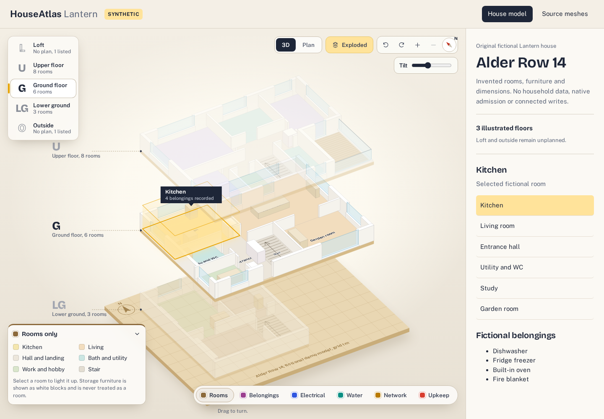
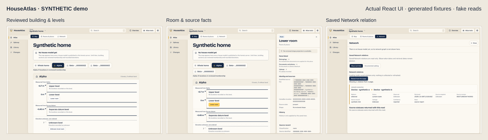

# HouseAtlas

The isolated canonical IFC source revision seam uses only generated receipts and
an in-memory SQLite ledger in these named checks. Inspect
`backend/src/media/canonical_ifc_source.rs` before running them:

```sh
cargo test --offline --locked -p houseatlas-backend --lib media::canonical_ifc_source::tests::synthetic_source_revision_validation -- --exact --test-threads=1
cargo test --offline --locked -p houseatlas-backend --lib media::canonical_ifc_source::tests::synthetic_source_ledger_parent_and_immutability -- --exact --test-threads=1
cargo test --offline --locked -p houseatlas-backend --lib media::canonical_ifc_source::tests::synthetic_source_ledger_rejects_atlas_schema -- --exact --test-threads=1
cargo test --offline --locked -p houseatlas-backend --lib media::canonical_ifc_source::tests::synthetic_source_requires_retained_ifc_bytes -- --exact --test-threads=1
cargo test --offline --locked -p houseatlas-backend --lib media::canonical_ifc_source::tests -- --test-threads=1
```

HouseAtlas connects rooms, belongings, documents and physical infrastructure in a home atlas. Browse a home without a floorplan, select a building and its reviewed rooms, and keep source dates, unknowns and evidence visible.

HomeBox owns inventory, attachments and maintenance; HouseAtlas owns physical identities, reviewed bindings and optional geometry, circuits and valves. Network observations are a separate passive, read-only source. Browsing does not collect data or write upstream.





**SYNTHETIC demo.** The illustrated house restores the original fictional Lantern design through the application's actual renderer. Its rooms, furniture and dimensions are invented. The separate generated mesh example has no native admission or room associations; the browsing fixture has no reviewed floorplan. No household files, real accounts or live providers are used. [Full screenshots and reproduction](docs/demo/README.md).

## Try the synthetic interface

Use Node **26.10.0** and npm **11.19.1**, then run from the repository root:

```sh
npm ci --prefix frontend --ignore-scripts --no-audit --no-fund
(cd frontend && node node_modules/vite/bin/vite.js --host 127.0.0.1 --port 4179 --strictPort)
```

Open <http://127.0.0.1:4179/lantern-tests/readme-house-visual/> for the fictional Lantern house. Select a room, switch between **3D** and **Plan**, or use **Source meshes** to inspect the separate generated two-floor scan renderer. Open <http://127.0.0.1:4179/lantern-tests/core-read-visual/> and select **Alpha** for building membership and source facts; in **Network**, choose **Load Network relations** for the fixture's saved relation. Stop the server with Ctrl-C.

The house demo uses production Lantern components and an explicitly fictional illustration fixture. The browsing demo uses read clients with synthetic Responses; the source-mesh demo uses generated meshes and the production WebGL renderer with display-only floor spacing. They supply no authentication, native server, evidence upload or provider integration. Keep it on loopback; do not use it as a deployment.

## What you can explore

- **Rooms and places:** reviewed building and floor membership, room records and explicit unplaced or unknown information. Names and tree depth do not establish physical placement.
- **Belongings and documents:** HomeBox projections, source-owned attachments, availability and maintenance. HomeBox edits use verified native links.
- **Geometry and infrastructure:** optional reviewed geometry and separately owned circuit, valve and evidence records. Geometry is not required for browsing.
- **Source history:** distinct fact and retrieval dates, uncertainty, stale caches and corrections. Passive Network reads never send collector demand.

Some capabilities require a configured native host and reviewed source bindings; these demos show fictional illustrated geometry, building/room browsing, a saved Network relation and separately generated provisional mesh presentation.

## Run the offline core checks

After inspecting the named script bodies, install the exact dependency locks and run the ordinary synthetic core:

```sh
npm ci --ignore-scripts --no-audit --no-fund
npm ci --prefix packages/contracts --ignore-scripts --no-audit --no-fund
npm run verify:publication
npm run build:ordinary
node --check packages/contracts/history/check-history.mjs
npm run check:http:ordinary
npm run test:ordinary
```

These checks cover publication integrity, module syntax/builds, valid HTTP history examples and one healthy synthetic Request group. They call no provider and certify no security, live integration or deployment readiness. New explicit source-presence admissions remain blocked pending their separately reviewed extension.

The separate IFC/GLB checks use a tiny generated triangle and fake local
transports. Inspect `backend/src/media/ifc_glb.rs` and
`frontend/lantern-tests/ifc-glb-read.mjs` before running them:

```sh
cargo test --offline --locked -p houseatlas-backend --lib media::ifc_glb::tests::healthy_ifc_glb_lineage_and_axes -- --exact --test-threads=1
cargo run --offline --locked -p houseatlas-backend --features serde_json/arbitrary_precision,serde_json/raw_value,jsonschema/arbitrary-precision --example healthy-native-ifc-glb
node frontend/lantern-tests/ifc-glb-read.mjs
```

They verify source-byte binding, bounded display parsing, synthetic native
custody/association/readback and persistent reopen, without proving converter
execution, IFC project units, physical alignment or native acceptance of a
household model.

The [IFC publication preparation](tools/ifc_publication/README.md) has a
separate local-only synthetic check. Inspect its Python source before running:

```sh
python3 -m unittest discover -s tools/ifc_publication -p test_publish.py
python3 -m unittest discover -s tools/ifc_publication -p test_publish_v2.py
python3 tools/ifc_publication/make_synthetic_fixture.py --output /tmp/houseatlas-ifc-synthetic
python3 tools/ifc_publication/make_synthetic_fixture_v2.py --output /tmp/houseatlas-ifc-synthetic-v2
```

These test v1 and v2 revision binding, repeatable fake conversion, occurrence
identity, and artifact hashes. They do not certify real IFC tessellation or
select a publication for live use. The proposed [v2 scene read contract](docs/canonical-ifc/scene-read-contract-v2.md)
and its two-floor synthetic fixture exercise one logical room spanning two
floor-qualified IFC space occurrences. Its routes and ready state are mock
contract examples, not live service behavior.

The isolated canonical viewer has a focused synthetic check:

```sh
node frontend/lantern-tests/canonical-ifc-viewer.test.mjs
```

It checks v2 artifact pins, occurrence selection and memory, overlay joins and
CPU geometry picking. The browser fixture is
`/lantern-tests/canonical-ifc-visual/?fixture=coverage` on the frontend dev
server; `a`, `b`, `scene` and `local` select the other fixture modes. Local files
use the closed HouseAtlas IFC-derived GLB profile and remain unbound to rooms
and floors. The viewer is not mounted in the application yet; these checks do
not qualify actual model placement, GPU picking or a live scene endpoint.

## Development and verification

The current development snapshot includes a Rust backend, SQLite persistence and a React interface with strict TypeScript.

[The complete verification guide](docs/contributing/verification.md) retains every previously documented named command and its scope, prerequisites and limitations. Read it before running any other check; broad suites and held controls are not authorized by this README.

- [Rust/React development slice](docs/rust-integration/README.md): actual native source, disposable local settings and exact ordinary commands.
- [UI integration](web/README.md): source ownership, access, freshness and host seams.
- [Repository coordination](docs/coordination/worker-handoff.md) and [publication provenance](docs/publication/provenance.md).
- [Operations and rollout](docs/operations/qualification-and-rollout.md): target and acceptance requirements.

This is a development snapshot. No household configuration, credentials or real media belong in Git. Ordinary CI uses no secrets and performs no deployment. Product, recovery, pilot and production acceptance remain separate. Open-source licensing is a future release decision; no license has been selected.
